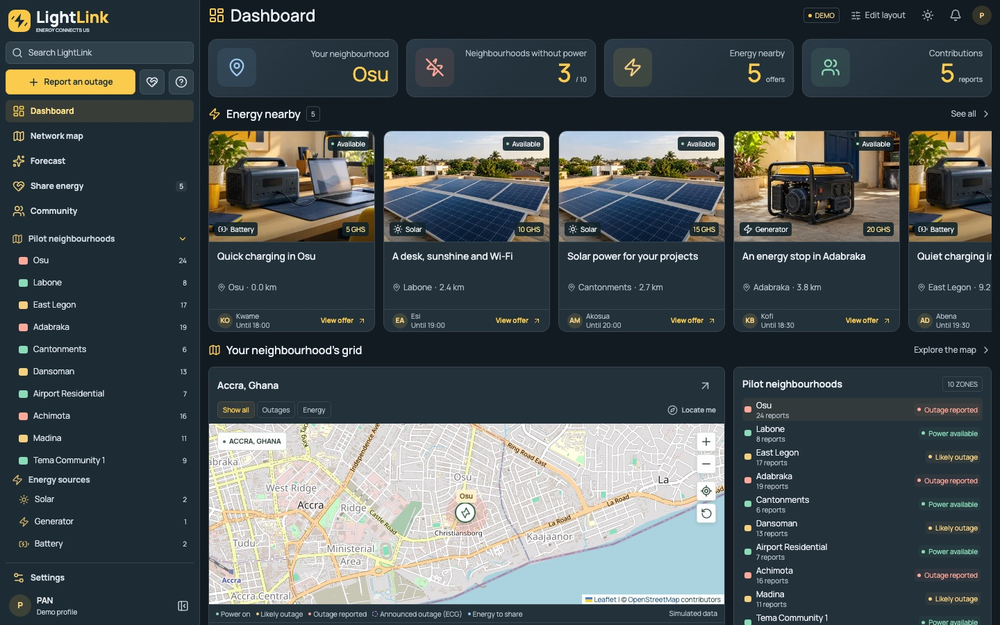
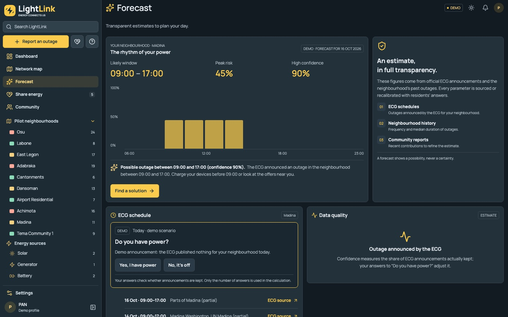
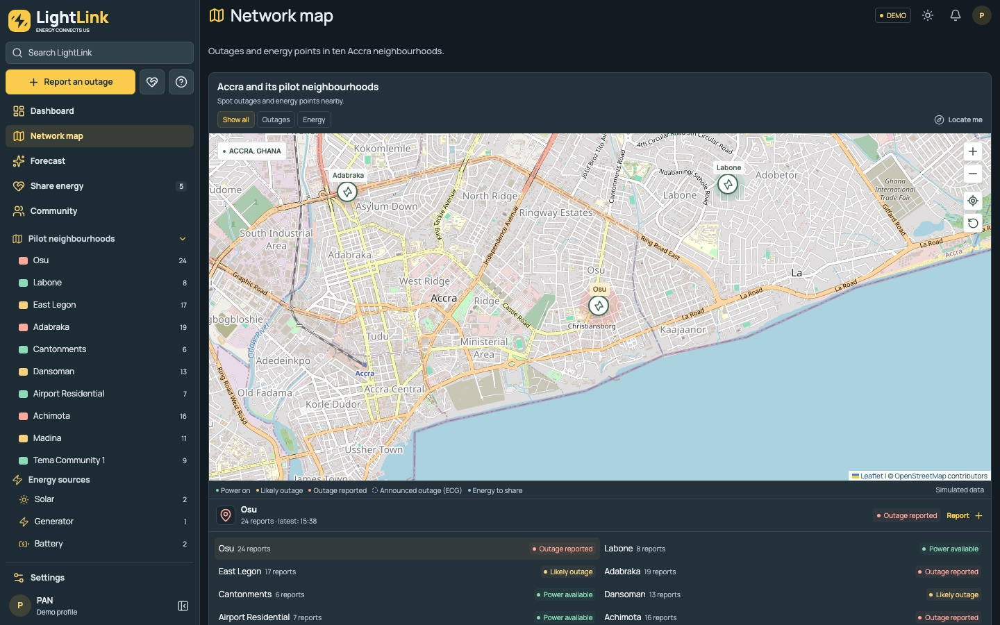
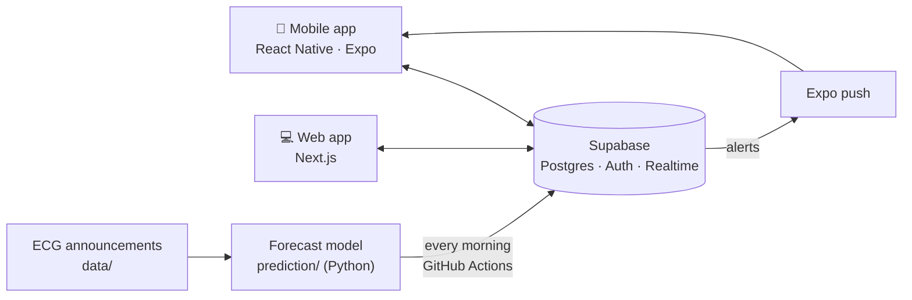

<div align="center">


# LightLink

**During dumsor, your neighbour becomes your power source.**

Know where the power is cut, see the next outage coming, and share energy with the people around you.

[](https://github.com/AliouneKane/lightlink/actions/workflows/ci.yml)
[](https://github.com/AliouneKane/lightlink/actions/workflows/daily-data.yml)


[](LICENSE)

Tech Hub Africa Hackathon 2026 · Track **Electricity Efficiency** · Accra, Ghana

[Architecture](docs/ARCHITECTURE.md) · [Forecast](docs/prediction.md) · [Sharing rules](docs/REGLES_PARTAGE.md) · [Tests](docs/TESTS.md) · [Security](docs/QUALITE_ET_SECURITE.md)



</div>

## The problem

In Ghana, power cuts (*dumsor*) are often local: one neighbourhood is in the dark while the next one still has power. Shops close, students cannot study, people lose hours looking for a socket, and the owners of generators, solar panels and batteries have energy to spare that nobody can reach. Official ECG announcements exist, but they are scattered across X, Instagram and the press, often as images.

## What LightLink does

| | Pillar | What residents get |
|:-:|---|---|
| 🗺️ | **Know** | A live map of the 10 pilot neighbourhoods built from residents' reports, with official ECG outages shown apart (planned or surprise). Reporting takes two taps and works offline. |
| 📈 | **Predict** | Hour-by-hour outage risk for the day: *"Likely outage between 09:00 and 17:00 (confidence 90%)"*, with an honest confidence level and *"not enough data"* when the data is thin. |
| 🔌 | **Share** | Neighbours offer solar, generator or battery power; others find the nearest offer, request a place, and see the exact address only once accepted. |
| 🔔 | **Alert** | Notifications when one's neighbourhood is cut, before an announced ECG outage, and when a request is received or answered. |

## Screenshots

<table>
  <tr>
    <td width="50%"><br /><sub><b>Forecast</b> — Madina on 16 Oct 2026, when the ECG announced an outage</sub></td>
    <td width="50%"><br /><sub><b>Network map</b> — reported outages and announced ECG outages</sub></td>
  </tr>
</table>

<table>
  <tr>
    <td></td>
    <td></td>
    <td></td>
    <td></td>
  </tr>
  <tr>
    <td align="center"><sub>Home</sub></td>
    <td align="center"><sub>Forecast</sub></td>
    <td align="center"><sub>Map</sub></td>
    <td align="center"><sub>Energy sharing</sub></td>
  </tr>
</table>

<sub>Screenshots in demo mode: the data shown is labelled as such in the app.</sub>

## How it works



- **The rules live in the database.** Anti-abuse limits, privacy of addresses, sharing rules and alerts are enforced by Postgres (row level security, triggers), so the web and mobile apps behave the same.
- **The forecast is explainable.** A rules model combines real ECG announcements with each neighbourhood's observed base rate; every parameter is sourced or measured ([details](prediction/README.md)). No model is trained on invented data.
- **Residents improve it.** During an announced outage the app asks *"Do you have power?"*: the answers measure how often ECG announcements are actually held.

More in [docs/ARCHITECTURE.md](docs/ARCHITECTURE.md).

## Quick start

The apps run in **demo mode** with no account and no key.

```sh
git clone https://github.com/AliouneKane/lightlink.git
cd lightlink

cd web && npm ci && npm run dev       # http://localhost:3000
cd ../mobile && npm ci && npm start   # scan the QR code with Expo Go (SDK 57)
```

**Live mode** reads and writes the real database: put the project's public URL and publishable key in `web/.env.local` and `mobile/.env` (variable names in [.env.example](.env.example)). [backend/README.md](backend/README.md) explains how to connect a Supabase project.

| You need | Version |
|---|---|
| Node.js | 24 LTS (as in CI) |
| Python | 3.9 or newer, standard library only |
| Expo Go | SDK 57, on the same Wi-Fi as the computer |
| Docker | Only to run Supabase locally |

## Repository

| Folder | Content |
|---|---|
| [`web/`](web/README.md) | Next.js web app |
| [`mobile/`](mobile/README.md) | React Native / Expo app |
| `shared/` | Logic shared by both apps: neighbourhood states, ECG announcements, forecasts, energy sharing |
| [`backend/`](backend/README.md) | Supabase migrations, seed, database tests and demo scripts |
| [`prediction/`](prediction/README.md) | Forecast model, ECG schedule import, backtest |
| `data/` | ECG announcements collected by the team, one CSV format for every source |
| [`docs/`](docs/README.md) | Architecture, forecast, sharing rules, tests, security, user journeys |

## Quality

| Check | Result |
|---|---|
| Automated tests | SQL (access rules, sharing, notifications), 32 Python, 53 web unit + 46 browser journeys, 21 mobile unit + 37 browser journeys, on every pull request |
| End-to-end on the hosted project | Anonymous report, realtime map, full energy-sharing flow between two residents |
| Speed | 10 forecasts computed in 32 ms; the app reads them in 170 ms |
| Load | 100 reports at once in 11 ms |
| Slow network | Content visible in 0.6 s on slow 3G; reports wait offline on the phone |
| Secrets | None in the whole Git history |

How to run each test: [docs/TESTS.md](docs/TESTS.md). Measurements and dependency audit: [docs/QUALITE_ET_SECURITE.md](docs/QUALITE_ET_SECURITE.md).

## Data

- **Official ECG announcements** from X, Instagram, the ECG website and the press ([sources](docs/SOURCES_HORAIRES_ECG.md)), stored in `data/`; new ones are copied by hand into [`data/saisie/`](data/saisie/README.md).
- **Residents' reports** and answers, aggregated by neighbourhood; a resident's position is never shown to others.
- **Simulated data is always labelled**: the demo mode shows the model's real output for 16 Oct 2026 with its date, and presentation data is marked *[SIMULATED]*.

## Known limits

- **Few outage data yet**: 21 dated days of ECG outages. The forecast is most reliable on days the ECG announces an outage; elsewhere the app shows a low confidence.
- **Announcement reliability starts as a prior** (0.90) until residents answer during announced outages.
- **ECG details published only as images** (Accra East, Tema) are copied by hand.
- **No payment** in energy sharing: the contribution is indicative.
- **Push notifications** need an installable build (Expo account); until then alerts are in the in-app inbox.
- **10 pilot neighbourhoods** in Greater Accra.

**Next**: read ECG images automatically, cover a whole ECG region, learn from residents' reports once enough days are collected, and ship the Android build.

## Team: LightLink Squad

| Member | Role |
|---|---|
| **Alioune Abdou Salam Kane** | Project lead and technical lead: backend, integration, CI |
| **Papa Amadou Niang** | Design and interface: web and mobile apps |
| **Judicaël Oscar Kafando** | Data and prediction: database, ECG schedules, forecast model |
| **Ndeye Ramatoulaye Ndoye Fall** | Product and communication: user journeys, README, demo video, pitch |

## License

[MIT](LICENSE)
