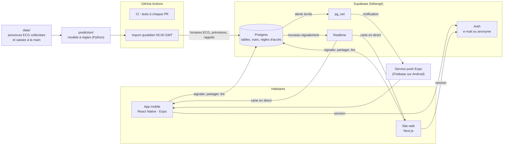

# Architecture et choix techniques

Tâches 144 et 149. Qui parle à qui, ce que stocke la base, et pourquoi ces choix.

## Schéma

## Les flux principaux

| Flux | Chemin |
|---|---|
| **Signaler** | L'app enregistre le signalement sur l'appareil, puis l'envoie à `outage_reports` (sur mobile, une file le garde tant qu'il n'y a pas de réseau). La base vérifie la limite de 5 en 10 minutes, la position (5 km) et l'heure d'observation. |
| **Carte en direct** | La vue `zone_status` calcule l'état de chaque quartier (2 dernières heures, prévu ou surprise). Realtime prévient les apps à chaque signalement, qui relisent la vue. |
| **Prévision** | Chaque matin, GitHub Actions calcule les prévisions du jour et du lendemain avec `prediction/` et les écrit dans `predictions`. Les apps les lisent. |
| **Partage d'énergie** | Offres, demandes et adresse privée dans des tables séparées ; `set_request_status()` contrôle chaque changement d'état ; `energy_options()` cherche autour du quartier. |
| **Notifications** | La base écrit elle-même les alertes dans `notifications` (boîte de réception) et les envoie au service push d'Expo par `pg_net`. |

## La base de données

| Table ou vue | Contenu | Qui peut lire / écrire |
|---|---|---|
| `zones` | Les 10 quartiers pilotes | Tout le monde lit |
| `profiles` | Nom et quartier de chaque habitant | Chacun le sien |
| `outage_reports` | Signalements (coupure, courant revenu, disponible, instable), heure d'observation, identifiant anti-doublon, « simulé » | Tout le monde lit ; chacun écrit les siens ; seul le script de démo écrit des « simulés » |
| `zone_status` (vue) | État de chaque quartier, coupure prévue ou surprise | Tout le monde |
| `ecg_schedules` | Horaires officiels de l'ECG (importés de `data/`) | Tout le monde lit ; seul l'import écrit |
| `announcement_outcomes` (vue) | Combien d'habitants coupés ou avec courant pendant chaque annonce | Chiffres seulement, jamais qui |
| `ecg_groups`, `zone_groups` | Groupes de délestage datés | Tout le monde lit |
| `predictions` | Prévisions du modèle | Tout le monde lit ; seul l'import écrit |
| `offers`, `offer_requests`, `offer_private_details` | Partage d'énergie | Voir [REGLES_PARTAGE.md](REGLES_PARTAGE.md) |
| `energy_places`, `abuse_reports` | Lieux d'énergie fixes ; signalements d'abus | Lieux publics ; abus lus par l'équipe seulement |
| `push_tokens`, `zone_follows`, `notifications` | Téléphones, quartiers suivis, boîte de réception | Chacun les siens |

Toutes les tables ont des règles d'accès (row level security), testées par `npm run test:sql` avec les vrais rôles `anon` et `authenticated`. Les migrations sont dans `backend/supabase/migrations/`, dans l'ordre.

## Les choix et leurs raisons

| Choix | Pourquoi | Ce qu'on a écarté |
|---|---|---|
| **Supabase** | Postgres + authentification + temps réel + règles d'accès dans un seul service gratuit ; la logique sensible (anti-abus, vie privée) vit dans la base, donc identique pour le web et le mobile ([DECISION_SUPABASE.md](DECISION_SUPABASE.md)) | Firebase : les signalements, quartiers et horaires sont des données reliées, mieux servies par SQL (décision d'Oscar et Salam, 14 octobre) |
| **React Native avec Expo** | Un seul code pour Android et iOS, test sur téléphone sans compiler (Expo Go), même langage (TypeScript) que le web | Flutter, prévu au départ : PAN a codé le front directement en React Native |
| **Next.js** | Site rapide, rendu côté serveur, même TypeScript que le mobile | |
| **Code partagé `shared/`** | Les règles d'affichage (état d'un quartier, prévision, partage) sont écrites une fois pour les deux apps | |
| **Modèle à règles en Python standard** | Explicable, chaque paramètre sourcé, aucune dépendance ; trop peu de données pour un modèle appris | Random Forest (tâche 114) : il apprenait des règles inventées, pas le dumsor |
| **Calcul quotidien par GitHub Actions** | Gratuit, sans serveur à maintenir ; les prévisions sont prêtes quand l'app les lit | Calcul à la demande : plus lent, serveur nécessaire |
| **Envoi des notifications par la base** | Les alertes partent au moment exact de l'événement, sans serveur ; `pg_net` est fourni par Supabase | Fonction serveur séparée |
| **Mode démo sans clé** | L'app tourne partout, même sans base, pour la démo et les tests ; les tests navigateur forcent ce mode | |
