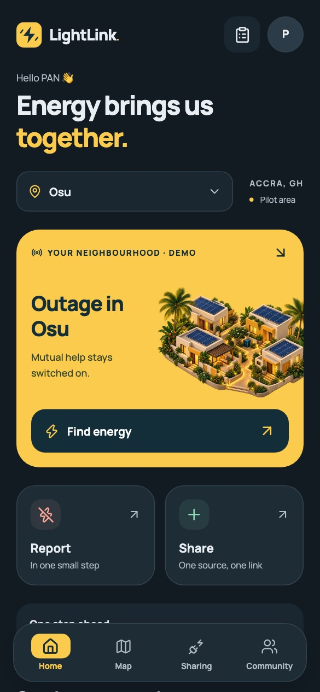
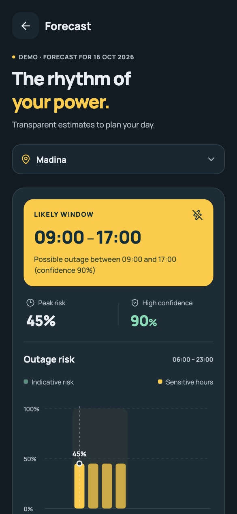
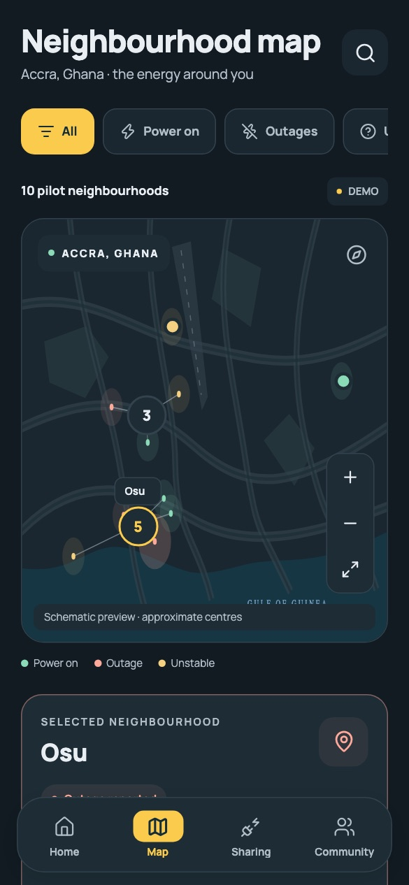
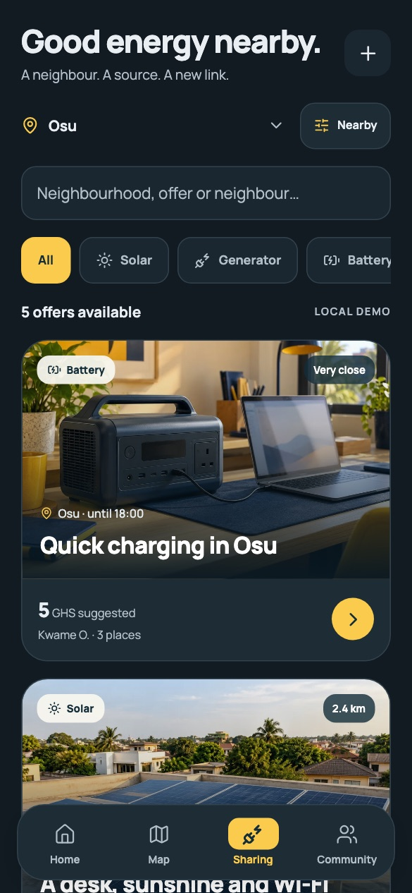

# LightLink · Mobile

The LightLink app for Android and iOS: power status of my neighbourhood, map, forecasts, two-tap reporting that works offline, and energy sharing between neighbours. Built with React Native and Expo.

<table>
  <tr>
    <td></td>
    <td></td>
    <td></td>
    <td></td>
  </tr>
</table>

## Run it on a phone

```sh
cd mobile
npm ci
npm start
```

1. Install **Expo Go for SDK 57** from [expo.dev/go](https://expo.dev/go).
2. Connect the phone to the **same Wi-Fi** as the computer (not a guest network or a VPN).
3. Scan the QR code: with the camera on iPhone, from Expo Go on Android.

If Expo Go asks you to sign in, start with `npx expo start --offline`, or sign in with `npx expo login`. On Windows PowerShell, use `npm.cmd run start:lan`; `npm.cmd run start:clear` also clears the Metro cache.

To look at the screens in a browser: `npm run web` (React Native Web; it does not test the native map, gestures or keyboard).

## Demo mode and live mode

Without `mobile/.env` the app runs in **demo mode**: data stays on the phone. For **live mode**, create `mobile/.env` with the project's public values (never the secret key):

```sh
EXPO_PUBLIC_SUPABASE_URL=https://<project-ref>.supabase.co
EXPO_PUBLIC_SUPABASE_ANON_KEY=<publishable key>
```

|                      | Demo mode                                            | Live mode                                                                                                        |
| -------------------- | ---------------------------------------------------- | ---------------------------------------------------------------------------------------------------------------- |
| Neighbourhood states | Demonstration scenario                               | Database, refreshed on every report (Realtime)                                                                   |
| Forecast             | Model output for 16 Oct 2026, labelled with its date | Today's forecast                                                                                                 |
| Reports              | Kept on the phone                                    | Sent to Supabase; **without network they wait on the phone** and leave when it comes back, in order, never twice |
| Offers and requests  | Kept on the phone                                    | Supabase: request a place, accept or refuse, exact address shown once accepted, report abuse                     |

If the database does not answer, neighbourhoods read _“Unknown status”_ instead of an invented state.

## Screens

| Route         | Screen                                                          |
| ------------- | --------------------------------------------------------------- |
| `/`           | Home: my neighbourhood, its state, forecast preview, shortcuts  |
| `/carte`      | Map of the 10 pilot neighbourhoods, filters, details            |
| `/partage`    | Energy offers by source and distance                            |
| `/communaute` | Recent reports                                                  |
| `/signaler`   | Report an outage, power back, or unstable power                 |
| `/previsions` | Forecast, risk by hour, ECG calendar and _“Do you have power?”_ |
| `/offre/[id]` | Offer details; for its host, the requests received              |
| `/publier`    | Publish an offer                                                |
| `/profil`     | Profile, my requests, my offers, theme, reset                   |

## Checks

```sh
npm run format:check
npm run lint
npm run typecheck
npm test                  # unit tests (offline queue, local storage)
npx expo install --check  # Expo packages match SDK 57
npx playwright install chromium
npm run test:e2e          # 37 journeys in a browser, forced to demo mode
```

The browser journeys do not replace a pass on a real Android or iOS phone.

## Structure

| Path                         | Content                                                       |
| ---------------------------- | ------------------------------------------------------------- |
| `src/app/`                   | Screens (Expo Router)                                         |
| `src/components/`            | UI kit, map (native and web), forecast chart                  |
| `src/providers/`             | Data provider (demo storage, live data, offline queue), theme |
| `src/lib/live.ts`            | Supabase client                                               |
| `src/lib/report-queue.ts`    | Offline report queue                                          |
| `src/lib/demo-repository.ts` | Demo data on the phone (AsyncStorage)                         |
| `tests/`                     | Playwright journeys                                           |

## Notes

- **Stack**: Expo SDK 57, React Native 0.86, React 19, TypeScript, Expo Router, AsyncStorage, `react-native-maps` (Google Maps on Android, Apple Maps on iOS).
- **Privacy**: positions shown are neighbourhood centres; a report's GPS position is never shown to others.
- **Installable build**: not published yet. An APK needs an EAS build (Expo account) and, for Google Maps on Android, a restricted Maps API key. Push notifications also need this build.
